# 📚 Frontend Application - เชื่อมต่อ API สำเร็จแล้ว!

## ✅ ไฟล์ที่สร้างขึ้น

```
C:\Users\User\Downloads\context\
├── index.html              ← หน้าแอปพลิเคชันหลัก
├── css/
│   └── style.css           ← สไตล์ทั้งแอป
└── js/
    ├── api.js              ← API client module
    └── app.js              ← Logic หลัก + generate()
```

---

## 🔌 การเชื่อมต่อ API

### 📍 Endpoint ที่เชื่อมต่อ
- **URL:** `POST http://localhost:8050/api/analysis/fill`
- **ไฟล์:** `js/api.js`
- **ฟังก์ชัน:** `analyzeDocument(file, category, language, notes)`

### 🎯 ฟังก์ชัน `generate()` ทำอะไร

```javascript
async function generate() {
    // 1️⃣ ตรวจสอบข้อมูล (validation)
    // 2️⃣ แสดง loading state
    // 3️⃣ เรียก API: analyzeDocument()
    // 4️⃣ รับผล response จาก /api/analysis/fill
    // 5️⃣ แสดงผล 4 document prototypes
    // 6️⃣ ให้ผู้ใช้เลือกและส่งออก
}
```

---

## 🚀 วิธีใช้

### ขั้นตอนที่ 1: ให้ Backend ทำงาน

```bash
# เปิด terminal และรันคำสั่งนี้
cd backend
python -m uvicorn app.main:app --reload --port 8050
```

**ผลลัพธ์ที่ควรเห็น:**
```
✅ Uvicorn running on http://127.0.0.1:8050
```

### ขั้นตอนที่ 2: เปิด Frontend

1. เปิด File Explorer
2. ไปที่: `C:\Users\User\Downloads\context\`
3. Double-click `index.html`
4. ตรวจสอบเบราวเซอร์ (Chrome, Edge, Firefox)

---

## 📊 ขั้นตอนการใช้งาน UI

### 1️⃣ อัปโหลดเอกสาร
- ลากไฟล์มาวางในกล่อง
- หรือคลิก "คลิกเพื่อเลือก"
- รองรับ: PDF, DOCX, TXT

### 2️⃣ ตั้งค่า
- **หมวดหมู่เอกสาร:** เลือก "Research Proposal (AP 02/2026)" หรือจำพวกอื่น
- **ภาษา:** เลือก English, ไทย, หรือ Both
- **หมายเหตุ:** (ไม่จำเป็น) เพิ่มหมายเหตุพิเศษ

### 3️⃣ คลิก "สร้างเอกสาร"
- ระบบจะเรียก API `/api/analysis/fill`
- แสดง loading animation ⏳
- รอผลลัพธ์ 📊

### 4️⃣ ดูผลลัพธ์
- **วิเคราะห์เอกสารต้นฉบับ:** ข้อมูลจากเอกสารที่อัปโหลด
- **4 รูปแบบเอกสาร:** เลือกระหว่าง Tab 1-4
- **ส่งออก:** ดาวน์โหลด DOCX หรือ PDF

---

## 🔧 ตั้งค่า API

ถ้าต้องการเปลี่ยน port หรือ host ของ API:

**ไฟล์:** `js/api.js` บรรทัด 5

```javascript
// เปลี่ยน URL ที่นี่
const API_BASE_URL = 'http://localhost:8050';

// ตัวอย่าง:
// const API_BASE_URL = 'http://127.0.0.1:8050';
// const API_BASE_URL = 'http://api.example.com';
```

---

## 📤 API Request Flow

```mermaid
graph LR
    A["👤 User\nอัปโหลดไฟล์"] --> B["🎯 generate()"]
    B --> C["✅ Validation\nตรวจสอบข้อมูล"]
    C --> D["⏳ showLoading()\nแสดง loading"]
    D --> E["🔌 analyzeDocument()\nเรียก API"]
    E --> F["📡 POST /api/analysis/fill\nส่งไฟล์ + ตั้งค่า"]
    F --> G["⚙️ Backend\nประมวลผล"]
    G --> H["✅ Response\nคืนผล 4 prototypes"]
    H --> I["📊 displayResults()\nแสดงผล"]
    I --> J["👤 User\nเลือก & ส่งออก"]
```



---

## 🔍 Debug & Troubleshooting

### ❌ ปัญหา: "API ไม่ตอบสนอง"

**วิธีแก้:**
1. ตรวจสอบ Backend ทำงานหรือไม่
   ```bash
   curl http://localhost:8050/health
   ```
2. ตรวจสอบ port ถูกต้องหรือไม่ (ควรเป็น 8050)
3. ตรวจสอบ browser console (F12 → Console)

### ❌ ปัญหา: "CORS Error"

**วิธีแก้:**
Backend ต้องเปิด CORS ให้ Frontend เชื่อมต่อได้

```python
# ในไฟล์ backend/app/main.py เพิ่ม:
from fastapi.middleware.cors import CORSMiddleware

app.add_middleware(
    CORSMiddleware,
    allow_origins=["*"],  # ⚠️ ใช้ ["http://localhost:3000"] ในสภาพ production
    allow_credentials=True,
    allow_methods=["*"],
    allow_headers=["*"],
)
```

### ❌ ปัญหา: "ไฟล์ไม่ได้อัปโหลด"

**วิธีแก้:**
1. ตรวจสอบประเภทไฟล์ (PDF, DOCX, TXT)
2. ตรวจสอบขนาด < 10MB
3. ตรวจสอบ browser console

### 📝 ดู Console Logs

```javascript
// ฟังก์ชันต่อไปนี้มี console.log() อยู่
generate()           // ↓ ดู progress
analyzeDocument()    // ↓ ดู API call
displayResults()     // ↓ ดู response
```

**วิธี:**
1. เปิด browser DevTools (F12)
2. ไปที่ "Console" tab
3. ดู logs สีเหลือง (⚠️) และสีแดง (❌)

---

## 📋 Response Structure

### API Response ที่คาดหวัง

```json
{
  "analysis": {
    "document_type": "Research Proposal",
    "language": "en",
    "purpose": "Research Ethics Submission",
    "status": "Complete",
    "errors": [
      "Missing researcher affiliation",
      "Unclear research objectives"
    ],
    "missing_fields": [
      "[PLEASE ENTER ETHICS APPROVAL NUMBER]",
      "[PLEASE ENTER PROJECT TIMELINE]"
    ]
  },
  "prototypes": [
    {
      "name": "Formal Academic Style",
      "description": "Academic formal version",
      "content": "...",
      "highlighted_sections": ["Introduction", "Methods"]
    },
    {
      "name": "Concise Business Style",
      "description": "Business concise version",
      "content": "...",
      "highlighted_sections": []
    },
    // ... 2 more prototypes
  ]
}
```

---

## 🎨 UI Components

| Component | ที่อยู่ | ทำงาน |
|-----------|--------|-------|
| Upload Area | index.html | ลาก-วาง + คลิกเลือก |
| Form Inputs | index.html | หมวดหมู่ + ภาษา + หมายเหตุ |
| Generate Button | index.html | เรียก `generate()` |
| Loading Spinner | js/app.js | แสดงระหว่างประมวลผล |
| Results Display | js/app.js | แสดง 4 prototypes |
| Export Buttons | index.html | ดาวน์โหลด DOCX/PDF |

---

## 🛠️ การแก้ไขเพิ่มเติม

### เปลี่ยนจำนวน Prototypes

**ไฟล์:** `js/app.js` ฟังก์ชัน `displayResults()`

```javascript
// เพิ่มหรือลบ Tab buttons ใน index.html:
<button class="tab-btn" onclick="switchPrototype(3)">รูปแบบ 4</button>
<button class="tab-btn" onclick="switchPrototype(4)">รูปแบบ 5</button>
```

### เพิ่มการตรวจสอบ Validation

**ไฟล์:** `js/app.js` ฟังก์ชัน `generate()`

```javascript
// เพิ่มเงื่อนไขตรวจสอบของคุณเอง:
if (!uploadedFile) {
    showError('❌ โปรดเลือกเอกสาร');
    return;
}
// ... เพิ่มเงื่อนไขใหม่ที่นี่
```

---

## 📞 Support

หากมีปัญหา:

1. **ตรวจสอบ Console:** F12 → Console
2. **ตรวจสอบ Backend:** `python -m uvicorn app.main:app --reload`
3. **ตรวจสอบ Port:** `localhost:8050` vs ต่อ port อื่น
4. **ตรวจสอบไฟล์:** `ap02_research_proposal.json` อยู่ที่ `backend/templates/`

---

## ✨ สรุป

✅ Frontend อัปโหลดเสร็จแล้ว  
✅ API integration พร้อม  
✅ `generate()` เชื่อมต่อกับ `/api/analysis/fill`  
✅ UI แสดง 4 document prototypes  
✅ Export to DOCX/PDF (เตรียมไว้)  

**ทดสอบได้เลยแล้ว!** 🚀
